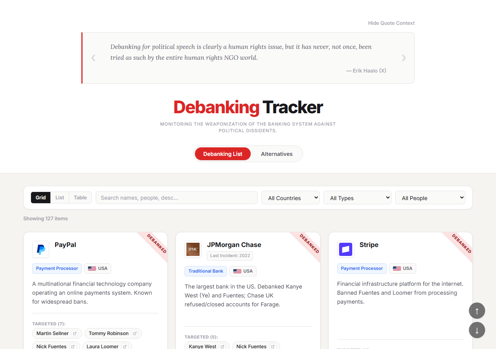
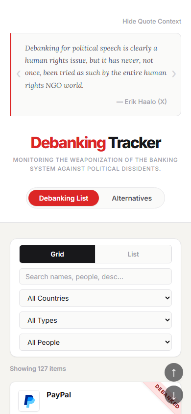
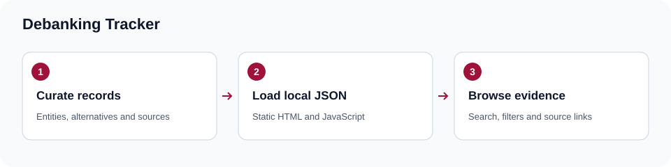

# Debanking Tracker

A static browser for a curated collection of debanking records, financial-service alternatives and source links. Search entities and people, filter by country or type, and switch between grid, list and table layouts.

## Screenshots

| Desktop records | Phone records |
| --- | --- |
|  |  |



## Run locally

```powershell
py -m http.server 8000 --bind 127.0.0.1
```

Open `http://127.0.0.1:8000/`. The page fetches the three JSON files, so use HTTP rather than opening `index.html` directly. No npm install or backend is required. Fonts, flags and third-party favicons are loaded from external services.

## How it works

| Path | Purpose |
| --- | --- |
| `debanking.json` | Curated entities and associated people |
| `debanking_alternatives.json` | Alternative-service records |
| `sources.json` | Entity/person source mappings, including global mappings |
| `script.js` | JSON loading, filtering, sorting and rendering |
| `index.html`, `style.css` | Page shell and presentation |

Update records and supporting sources together, validate the JSON, then inspect all layouts. A listed claim remains the claim of its cited source; this repository cleanup does not independently verify the underlying allegations or assess the suitability of a financial service.

For a quick syntax check, use `node --check script.js`. There is no automated test suite or package manifest in this checkout. The existing browser favicon is retained; the root SVG supplies a compact project mark.
